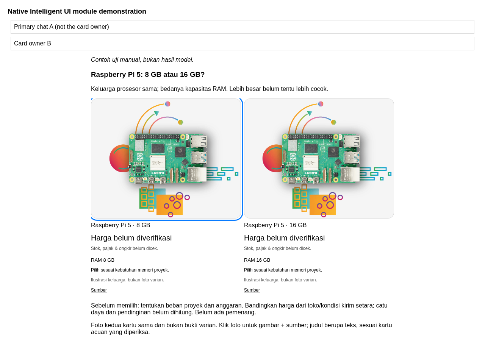

# Aero photo cards: verification scope

This is a partial reference-imitation implementation, not completion of the full Intelligent UI outcome. It adds `visualcard`/`visualcards` to Aero without removing the original eight `ui` kinds. No merge, permanent installation, provider activation, spending or map dependency is included.

## Source and build

- `desktop/src/aero-baseline.js` SHA256 `b63d27fd97b883c8acd35fc44acb1c27d57300c9297a127efbd55e88753aba0f` preserves PR30 head495624de's renderer.
- `desktop/src/index.mjs` calls the existing registration and adds the photo directives. Public SDK session state closes a retained viewer on navigation; renderer-owner changes and unmount also close it. X/Escape restore the original photo trigger; navigation does not restore focus to the old card.
- `tests/runtime/build-plugin.mjs` rebuilds the committed bundle. Its SHA256 `55c243b9d9e7d4ec7557a2754952ebe6f3c55be3526b94c1bf9ef72680cc1f9b` is the current Sonar-repair rebuild, not the artifact used for the full combined-v8 host matrix. It changes only the explicit alphabetical comparator; the test harness uses deterministic session IDs. Local checks:15Node tests, both Chromium harnesses,6Python contracts and8scanner groups. Independent targeted current-bundle full-host smoke passed: a/b photo order, legacy titles at1280without page overflow, viewer Escape/X restores exact trigger focus, programmatic session change clears overlay and focuses composer, and zero page errors. This narrow smoke does not repeat the full earlier matrix.
- Test harness adapters now select the `ui` registration by name rather than assuming it is the last registered directive. Existing behavioral assertions remain.

The full combined-v8 host matrix below exercised the earlier bundle SHA256 `0cfd12ee5425c82030dfb72abbcbb715251b0e25005fae622ba0388606cfb108`. It must not be attributed to the current rebuild.

## Evidence levels

| Evidence | Actual scope | Not proved |
|---|---|---|
| Six Python contract tests | Preserved readable `ui` source/catalog contract | Bundle behavior or new media contract |
| Original13DOM interaction tests | Combined bundle, fake SDK/storage, original8kinds/actions/state isolation | Real host delivery or model choice |
| Photo schema test | Bounds, URL refusal, required price/note pair | Remote media trust or data accuracy |
| Chromium legacy smoke + photo browser | Pinned parser, fake SDK atoms/composer;320/390/1280; viewer boundary/zoom/close/owner switch/unsafe values/zero sends | Full Hermes or live model output |
| Native-module10group run, private v8 candidate | Actual host Markdown/SDK module graph with cached image interception and separate focus delta | Full shell or model selection |
| Independent combined-v8 full-shell check | Manual fixture in isolated Hermes, desktop1280 and mobile390; all8legacy types+2photo cards, real touch scroll, X/Escape exact opener focus, actual SDK-state navigation closes overlay, saved combined reopen | Real model generation, every legacy action permutation, universal listener cleanup or unpatched-core compatibility |

A later combined-v8 full-shell probe individually targeted the Name and Notes fields and verified the exact structured form payload as a sent message in an unchanged owning-session hash, with zero page errors. The response was a scripted fake-provider acknowledgment, not live-model proof or a composer-prefill-only observation. Repeated reopen/close showed one viewer and no observed page errors; this is not a proof that every listener is absent. No previous isolated v7/v7.3 pass is counted as combined-v8 acceptance.

## Visual evidence

These committed images are deterministic native-module harness screenshots, not the user's account, reference conversation, full Hermes shell or model output. The family illustration is repeated deliberately and labeled, not variant-photo evidence.

[390px fixture](../tests/runtime/evidence/reference-390.png) and [390px photo/source-only viewer](../tests/runtime/evidence/photo-viewer-390.png). Original source: https://www.raspberrypi.com/products/raspberry-pi-5/ . Browser CI uses a synthetic image rather than claiming photo provenance.

## Reference and remaining gaps

The settled ChatGPT desktop reference had photos above plain titles and prices; photo click opened image/source-only viewer. Normal title click did nothing and the title was not inside a button/link. This implementation preserves that boundary, not a custom details popup. The reference also has download and image-type controls which are absent here. Native-mobile reference behavior was not established; the horizontal mobile row is tested usability, not exact mobile fidelity.

Fresh varied unseen real-model selection, correct model-emitted serialization and sourced media/data have NOT been proved for this photo path. The skill documents the new directives but a skill edit is not acceptance evidence. Unknown prices/stock/tax/shipping remain visible. No purchase/winner claim is made. HTTPS validation/referrer suppression does not establish that an arbitrary media endpoint is safe or accurate.

The full-shell/native-module photo harness used an existing separate focus-retry core delta. That patch is not included or silently merged into this plugin PR; the plugin adds no new core edit. Unpatched-host focus behavior remains a deployment blocker to resolve through its own review, not a claim hidden by a passing harness.

Maps remain blocked on the user's net-Rp0/no-PAYG condition. No new API key, billing, account, paid call or substitute provider was activated. Other interaction families (maps, video, charts, learning flows) are not complete merely because this photo boundary works.
